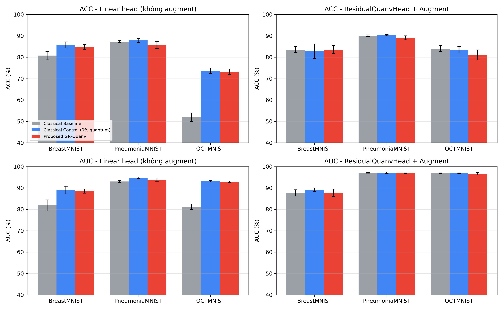
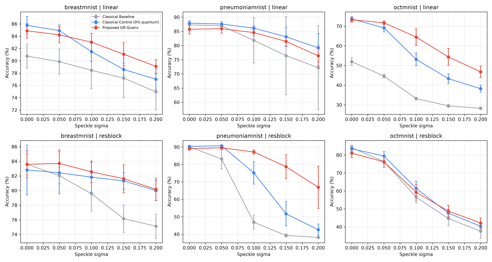

# Báo cáo mở rộng Cột trụ 2: đa tập dữ liệu, Residual head, kháng nhiễu đốm

Nguồn: `reports/pillar2_expansion_results.json`; mã: `experiments/run_pillar2_expansion.py`. 5 seeds [0, 42, 100, 2023, 777], chọn epoch theo val, test đánh giá 1 lần, mọi mô hình cùng head/augment/siêu tham số.
Tham số: Control cổ điển luôn >= GR-Quanv (đối chứng không bị thiệt).

## Kết quả sạch - Linear head (không augment)

| Tập | Mô hình | Tham số | ACC (%) | AUC (%) | F1 (%) |
|---|---|---|---|---|---|
| breastmnist | Classical Baseline | 1598 | 80.77 ± 1.94 | 81.85 ± 2.60 | 87.21 ± 1.36 |
| breastmnist | Classical Control (0% quantum) | 9506 | 85.77 ± 1.43 | 89.01 ± 1.78 | 90.34 ± 1.05 |
| breastmnist | Proposed GR-Quanv | 9406 | 84.87 ± 1.19 | 88.55 ± 0.99 | 89.95 ± 0.70 |
| pneumoniamnist | Classical Baseline | 1598 | 87.31 ± 0.45 | 93.04 ± 0.45 | 90.61 ± 0.34 |
| pneumoniamnist | Classical Control (0% quantum) | 9506 | 87.88 ± 0.91 | 94.78 ± 0.34 | 91.01 ± 0.61 |
| pneumoniamnist | Proposed GR-Quanv | 9406 | 85.74 ± 1.69 | 93.78 ± 0.86 | 89.59 ± 1.10 |
| octmnist | Classical Baseline | 3168 | 51.98 ± 1.98 | 81.23 ± 1.28 | 46.13 ± 2.49 |
| octmnist | Classical Control (0% quantum) | 11076 | 73.68 ± 1.23 | 93.20 ± 0.39 | 72.21 ± 1.62 |
| octmnist | Proposed GR-Quanv | 10976 | 73.26 ± 1.26 | 92.87 ± 0.31 | 71.36 ± 1.68 |

GR-Quanv so với Control cổ điển (t-test ghép cặp theo seed, n=5):

| Tập | ΔACC (điểm) | p (ACC) | ΔAUC (điểm) | p (AUC) |
|---|---|---|---|---|
| breastmnist | -0.90 | 0.475 | -0.47 | 0.686 |
| pneumoniamnist | -2.15 | 0.115 | -1.00 | 0.138 |
| octmnist | -0.42 | 0.393 | -0.34 | 0.285 |

## Kết quả sạch - ResidualQuanvHead + Augment

| Tập | Mô hình | Tham số | ACC (%) | AUC (%) | F1 (%) |
|---|---|---|---|---|---|
| breastmnist | Classical Baseline | 56286 | 83.59 ± 1.44 | 87.69 ± 1.49 | 89.41 ± 0.87 |
| breastmnist | Classical Control (0% quantum) | 64194 | 82.82 ± 3.40 | 89.17 ± 0.83 | 88.18 ± 3.07 |
| breastmnist | Proposed GR-Quanv | 64094 | 83.59 ± 1.84 | 87.73 ± 1.74 | 88.99 ± 0.95 |
| pneumoniamnist | Classical Baseline | 56286 | 90.10 ± 0.38 | 97.11 ± 0.22 | 92.54 ± 0.27 |
| pneumoniamnist | Classical Control (0% quantum) | 64194 | 90.35 ± 0.31 | 97.12 ± 0.38 | 92.71 ± 0.20 |
| pneumoniamnist | Proposed GR-Quanv | 64094 | 89.10 ± 0.95 | 96.93 ± 0.14 | 91.85 ± 0.61 |
| octmnist | Classical Baseline | 56384 | 84.08 ± 1.47 | 96.91 ± 0.15 | 83.61 ± 1.63 |
| octmnist | Classical Control (0% quantum) | 64292 | 83.48 ± 1.49 | 96.98 ± 0.12 | 82.93 ± 1.64 |
| octmnist | Proposed GR-Quanv | 64192 | 81.06 ± 2.41 | 96.59 ± 0.55 | 80.29 ± 2.74 |

GR-Quanv so với Control cổ điển (t-test ghép cặp theo seed, n=5):

| Tập | ΔACC (điểm) | p (ACC) | ΔAUC (điểm) | p (AUC) |
|---|---|---|---|---|
| breastmnist | +0.77 | 0.625 | -1.45 | 0.198 |
| pneumoniamnist | -1.25 | 0.048 | -0.18 | 0.383 |
| octmnist | -2.42 | 0.244 | -0.39 | 0.221 |

## Kháng nhiễu đốm (huấn luyện trên ảnh sạch, test có nhiễu; mỗi sigma trung bình 3 lần lấy mẫu nhiễu)

### breastmnist - Linear head (không augment)

| sigma | Classical Baseline | Control (0% quantum) | GR-Quanv | Δ(GR-Control) | p |
|---|---|---|---|---|---|
| 0.00 | 80.77 ± 1.94 | 85.77 ± 1.43 | 84.87 ± 1.19 | -0.90 | 0.475 |
| 0.05 | 79.87 ± 2.03 | 84.91 ± 0.92 | 84.23 ± 1.31 | -0.68 | 0.422 |
| 0.10 | 78.46 ± 2.99 | 81.50 ± 1.61 | 83.03 ± 1.44 | +1.54 | 0.001 |
| 0.15 | 77.18 ± 3.18 | 78.59 ± 1.03 | 81.07 ± 1.89 | +2.48 | 0.024 |
| 0.20 | 74.96 ± 2.90 | 77.01 ± 1.69 | 79.10 ± 1.12 | +2.09 | 0.095 |

### pneumoniamnist - Linear head (không augment)

| sigma | Classical Baseline | Control (0% quantum) | GR-Quanv | Δ(GR-Control) | p |
|---|---|---|---|---|---|
| 0.00 | 87.31 ± 0.45 | 87.88 ± 0.91 | 85.74 ± 1.69 | -2.15 | 0.115 |
| 0.05 | 86.93 ± 0.86 | 87.59 ± 0.82 | 85.93 ± 1.57 | -1.66 | 0.121 |
| 0.10 | 81.85 ± 7.99 | 86.15 ± 0.75 | 84.57 ± 1.14 | -1.58 | 0.159 |
| 0.15 | 76.43 ± 13.79 | 83.08 ± 3.43 | 81.46 ± 1.70 | -1.61 | 0.371 |
| 0.20 | 72.19 ± 14.80 | 79.20 ± 5.02 | 76.38 ± 3.54 | -2.82 | 0.254 |

### octmnist - Linear head (không augment)

| sigma | Classical Baseline | Control (0% quantum) | GR-Quanv | Δ(GR-Control) | p |
|---|---|---|---|---|---|
| 0.00 | 51.98 ± 1.98 | 73.68 ± 1.23 | 73.26 ± 1.26 | -0.42 | 0.393 |
| 0.05 | 44.63 ± 0.96 | 69.17 ± 2.03 | 71.75 ± 0.98 | +2.58 | 0.019 |
| 0.10 | 33.21 ± 0.74 | 53.14 ± 3.26 | 64.47 ± 4.22 | +11.33 | 0.018 |
| 0.15 | 29.47 ± 0.75 | 43.33 ± 2.48 | 54.37 ± 4.33 | +11.04 | 0.020 |
| 0.20 | 28.26 ± 0.69 | 38.22 ± 1.82 | 46.78 ± 2.95 | +8.56 | 0.017 |

### breastmnist - ResidualQuanvHead + Augment

| sigma | Classical Baseline | Control (0% quantum) | GR-Quanv | Δ(GR-Control) | p |
|---|---|---|---|---|---|
| 0.00 | 83.59 ± 1.44 | 82.82 ± 3.40 | 83.59 ± 1.84 | +0.77 | 0.625 |
| 0.05 | 82.05 ± 1.12 | 82.44 ± 2.88 | 83.72 ± 1.83 | +1.28 | 0.349 |
| 0.10 | 79.57 ± 2.36 | 81.84 ± 2.07 | 82.56 ± 1.48 | +0.73 | 0.640 |
| 0.15 | 76.15 ± 1.87 | 81.32 ± 1.12 | 81.62 ± 1.93 | +0.30 | 0.821 |
| 0.20 | 75.13 ± 1.64 | 80.00 ± 1.36 | 80.17 ± 1.54 | +0.17 | 0.842 |

### pneumoniamnist - ResidualQuanvHead + Augment

| sigma | Classical Baseline | Control (0% quantum) | GR-Quanv | Δ(GR-Control) | p |
|---|---|---|---|---|---|
| 0.00 | 90.10 ± 0.38 | 90.35 ± 0.31 | 89.10 ± 0.95 | -1.25 | 0.048 |
| 0.05 | 83.12 ± 5.65 | 90.73 ± 0.35 | 89.54 ± 0.87 | -1.19 | 0.046 |
| 0.10 | 46.83 ± 3.93 | 75.18 ± 6.40 | 87.14 ± 1.22 | +11.96 | 0.017 |
| 0.15 | 39.29 ± 0.87 | 51.68 ± 6.91 | 78.70 ± 6.89 | +27.02 | 0.002 |
| 0.20 | 38.18 ± 0.45 | 42.61 ± 3.23 | 66.91 ± 12.13 | +24.31 | 0.013 |

### octmnist - ResidualQuanvHead + Augment

| sigma | Classical Baseline | Control (0% quantum) | GR-Quanv | Δ(GR-Control) | p |
|---|---|---|---|---|---|
| 0.00 | 84.08 ± 1.47 | 83.48 ± 1.49 | 81.06 ± 2.41 | -2.42 | 0.244 |
| 0.05 | 76.35 ± 1.36 | 79.49 ± 2.48 | 76.21 ± 3.15 | -3.28 | 0.281 |
| 0.10 | 56.54 ± 3.24 | 61.43 ± 3.91 | 59.29 ± 4.39 | -2.15 | 0.615 |
| 0.15 | 44.61 ± 3.82 | 47.65 ± 2.28 | 48.78 ± 3.26 | +1.13 | 0.665 |
| 0.20 | 37.57 ± 3.89 | 40.31 ± 1.56 | 42.13 ± 2.86 | +1.82 | 0.289 |

## Biểu đồ

